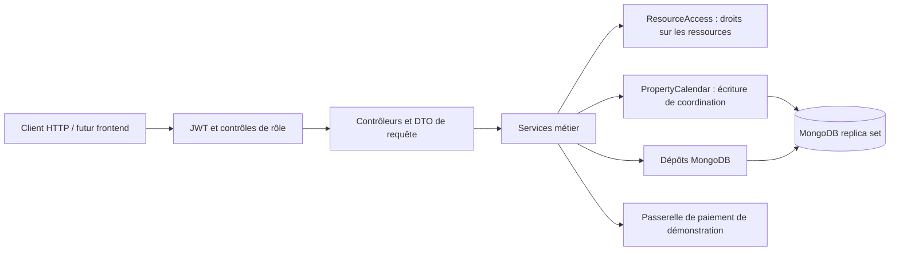
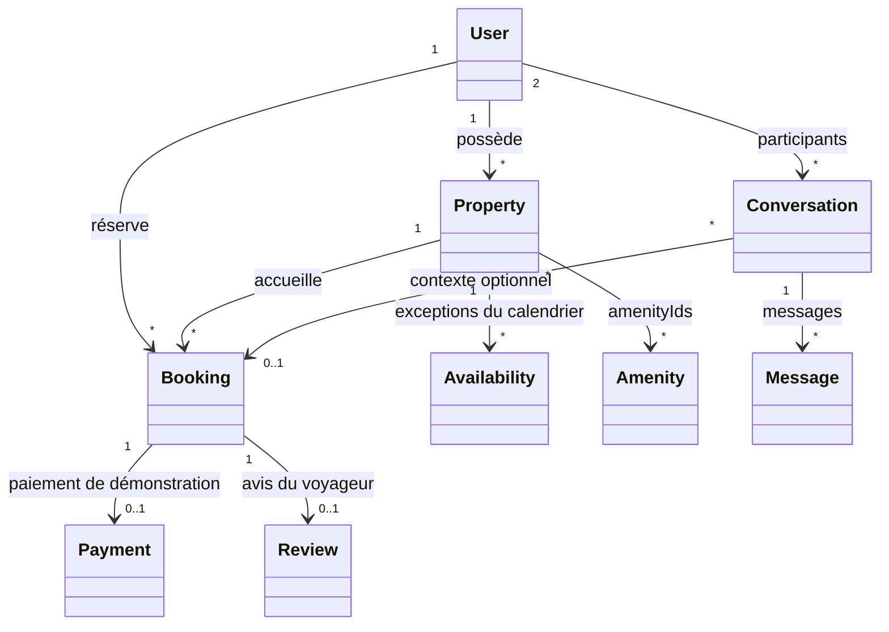
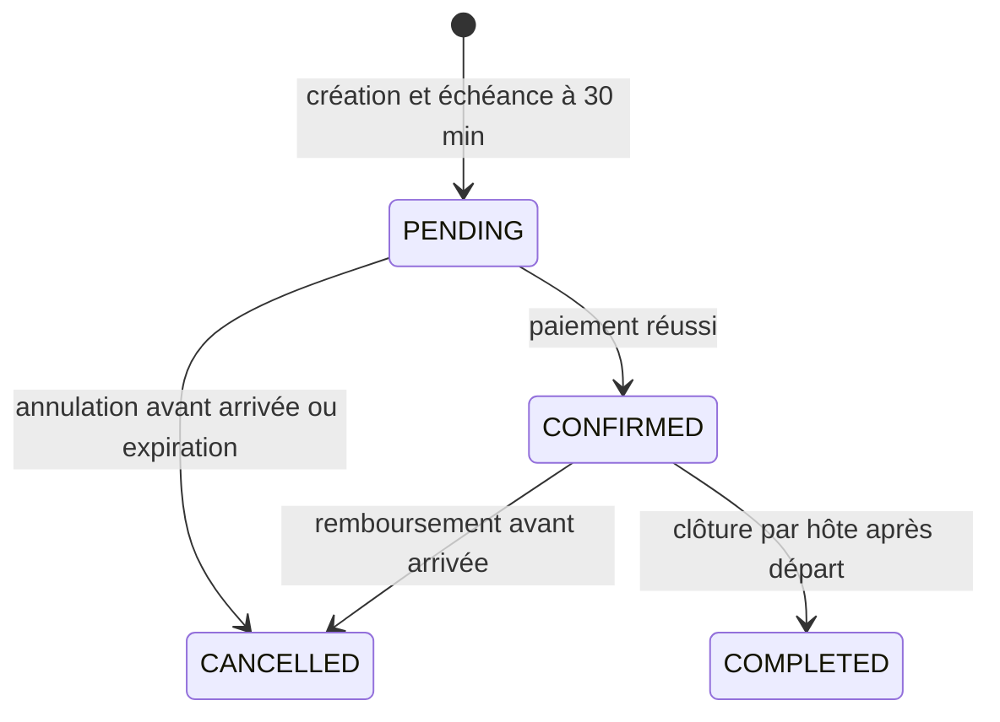

# Audit et architecture du backend

## Besoin retenu

Le dépôt décrit une plateforme de location de logements : voyageurs, hôtes, catalogue, équipements, calendrier, réservations, paiements, avis et messagerie privée. Cette interprétation vient des classes et des routes existantes ; aucun cahier des charges supplémentaire n'est présent.

Le choix retenu est un monolithe Spring Boot en couches. Les fonctionnalités partagent les mêmes invariants de réservation et une seule base ; une séparation en microservices augmenterait ici le coût de cohérence.

## Incohérences corrigées

| Constat dans le dépôt initial | Correction |
| --- | --- |
| Rôle OWNER demandé par les contrôleurs mais absent de Role ; aucun parcours hôte | ROLE_OWNER, activation du rôle hôte pour l'utilisateur connecté |
| Configuration JWT absente ; durée de réponse codée en dur | Secret externe obligatoire, contrôle de longueur, durée configurable et cohérente |
| Lecture, paiement et remboursement accessibles sans contrôle du lien avec la réservation | ResourceAccess contrôle le voyageur, l'hôte du logement et l'administrateur selon l'action |
| Identifiants client utilisés comme identité dans la messagerie | Identité issue du JWT ; identifiants senderId, authorId et userId des créations ignorés |
| Liste des réservations d'un logement accessible à tout utilisateur connecté | Accès réservé à son hôte et à l'administrateur |
| Capacité, ordre des dates et réservation de son propre logement non vérifiés | Invariants vérifiés avant la création |
| Recherche puis insertion permettaient deux réservations simultanées | Transaction et écriture sur le document du logement avant la vérification des nuits |
| @Transactional sans MongoTransactionManager | Gestionnaire déclaré et environnement replica set fourni |
| Double pour les prix et montants | BigDecimal et stockage BSON Decimal128 |
| Jour de départ inclus dans les prix spéciaux et les indisponibilités | Intervalle [arrivée, départ) dans les requêtes de calendrier |
| Réservation payée annulable sans remboursement ; clôture de séjour absente | Transitions contrôlées, remboursement et annulation atomiques, route de clôture |
| Réservations PENDING sans échéance | Expiration après 30 minutes et libération périodique |
| Paiement aléatoire présenté comme une passerelle externe | Simulation déterministe et explicitement activée ; mode par défaut désactivé |
| Aucun identifiant prestataire enregistré ; paiement rejouable | Identifiant de transaction enregistré, unicité par réservation, appels répétés idempotents |
| Unicité des avis, jours et conversations vérifiée uniquement en Java | Index uniques MongoDB |
| Archivage et aperçu des messages partagés entre les deux participants | Archivage par participant et aperçu calculé sur ses messages visibles |
| Ajout d'un rôle sur Set.of non modifiable | Copie modifiable avant ajout et validation du rôle |
| Suppression d'utilisateur cassant l'historique et exposition possible du hash | Désactivation, refus des anciens JWT, DTO administrateur, champ password non sérialisable |
| Type de logement libre malgré un enum existant ; photos uniquement dans un DTO inutilisé | PropertyType dans le modèle et stockage imageUrls |
| Requêtes visant des champs inexistants et paramètres de mise à jour erronés | Correction des dépôts et suppression des anciens helpers de conversation inutilisés |
| Validations sans contraintes effectives et erreurs métier HTTP 500 | DTO validés et erreurs structurées 400, 401, 403, 404, 409 et 503 |
| Origine CORS répétée dans chaque contrôleur | Configuration CORS centralisée |

## Modèle de classes

Les références MongoDB restent des identifiants ; il n'y a pas de cascades automatiques. Les réservations et paiements doivent être conservés pour l'historique. La suppression d'un logement est logique. Les équipements référencés doivent exister.

Le calendrier stocke des exceptions de disponibilité et de prix. Les réservations actives restent la source d'occupation des nuits. L'absence d'une exception signifie disponible au tarif de base, sous réserve des réservations existantes et du statut du logement.

Une conversation est unique par paire d'utilisateurs, triée avant l'insertion. Sa réservation constitue un contexte optionnel initial et ne transforme pas la conversation en fil distinct par séjour.

## Réservation et concurrence

Toutes les créations de réservation et modifications du calendrier touchent le même document Property dans leur transaction avant de lire les conflits. Deux écritures concurrentes sur ce logement ne peuvent donc pas valider des calendriers incompatibles. Un conflit renvoie 409 et le client recharge les données. Les champs @Version protègent aussi les transitions et les modifications concurrentes de documents.

Le paiement en mode demo et la réservation sont écrits dans la même transaction. Cela garantit la cohérence de la simulation locale. Une transaction MongoDB ne peut pas annuler un débit réel chez Stripe ou PayPal : un futur adaptateur réel devra utiliser une clé d'idempotence, des webhooks signés, des états de traitement durables et une procédure de rapprochement.

Documentation technique : [transactions MongoDB](https://www.mongodb.com/docs/manual/core/transactions-production-consideration/), [gestionnaire Spring Data](https://docs.spring.io/spring-data/mongodb/reference/mongodb/client-session-transactions.html), [verrouillage optimiste](https://docs.spring.io/spring-data/data-mongodb/reference/mongodb/template-crud-operations.html), [montants Decimal128](https://docs.spring.io/spring-data/mongodb/reference/mongodb/mapping/custom-conversions.html).

## Limites et suite frontend

Le backend est conçu pour une démonstration fonctionnelle. Une mise en production doit aussi traiter les paiements réels, la rotation et révocation des JWT, la récupération de mot de passe, la vérification d'email, la pagination, les limites de débit, le stockage et contrôle des images, les devises, les fuseaux horaires métier et l'observabilité. Le logout actuel accuse réception ; le frontend doit effacer le JWT, qui reste valide jusqu'à son expiration ou la désactivation du compte.

La recherche est encore adaptée à un petit catalogue : filtrage par ville puis vérifications par logement. Pour un catalogue volumineux, prévoir des requêtes de recherche et de disponibilité agrégées et paginées.

## Vérifications

La suite couvre les règles de dates et de validation, les JWT et la protection des secrets dans les diagnostics. Les 12 tests d'intégration utilisent le vrai contexte Spring et MongoDB dans Docker : identité du JWT, inscription et rôle hôte, tarifs décimaux, jour de départ exclusif, droits sur les ressources, création concurrente, remboursement idempotent, rollback en cas d'échec de passerelle, calendrier, archivage privé, avis, expiration et désactivation des comptes.

L'interface à construire pourra suivre les parcours catalogue et recherche, détail du logement, authentification, réservation et paiement demo, voyages et avis, espace hôte, messagerie et administration. Aucun framework frontend n'est encore installé dans ce dépôt.
